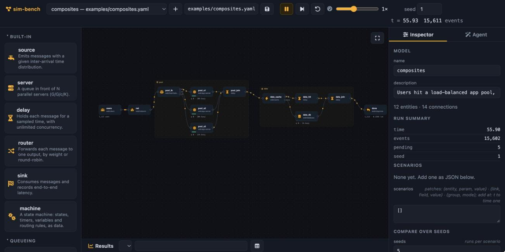

[](https://github.com/epatel/sim-bench/actions/workflows/ci.yml)
[](https://github.com/epatel/sim-bench/actions/workflows/audit.yml)
[](https://scorecard.dev/viewer/?uri=github.com/epatel/sim-bench)

<a href="https://claude.ai"></a>

# Simulation Workbench (sim-bench)

## TL;DR

Draw a system (clients, load balancers, servers, queues, caches, databases) on a canvas, and
a discrete-event simulator runs it live. You can ask "what if": more servers, a slow
database, a link that goes down. Answers come with confidence intervals. A built-in Claude
agent can edit the model, or read another project's source code and propose a model of it.
It runs locally and uses your Claude subscription, not an API key.

```sh
python3 -m venv .venv && .venv/bin/pip install -r requirements-dev.txt
.venv/bin/python -m server --reload   # open http://127.0.0.1:8765
```



## What it does

A local workbench for **discrete-event simulation**. A Python server simulates entities
that exchange messages and react to events. You build, run and watch the model on a browser canvas.
A Claude agent can edit and run the model, and can build models by reading other projects' source code.

- **Canvas editor**: place items (Font Awesome icons), connect ports, edit parameters,
  run / pause / step / stop with animated messages and metric badges.
- **Coarse to fine**: groups are composites with boundary ports. Keep a group *abstract* (one
  calibrated stand-in) or *expanded* (its members simulated), and focus on one path.
  Calibration fits a stand-in that matches the group's latency and saturates at its capacity.
- **Behaviors in three tiers**: stochastic built-ins (source, server, delay, router,
  sink), state machines written as small, safe scripts (with model-wide constants and functions), and Python behaviors for the rest.
- **Libraries and templates**: item types with inheritance and parameterized
  sub-models (`libraries/web`, `libraries/queueing`, `libraries/ecology`).
- **What-if scenarios**: patches on parameters, links or group modes, optionally at a time
  (fault injection). Batch runs over seeds report a mean and 95% CI. "What if, from here"
  forks a paused run with common random numbers.
- **In-app agent** (Claude Agent SDK): chat next to the canvas. It edits the model through
  workbench tools, runs scenarios, and reads registered source folders to *propose* a model
  that you accept or reject as a diff on the canvas, with file:line provenance.

## Quick start

Needs Python 3.12 (what CI tests).

```sh
python3 -m venv .venv && .venv/bin/pip install -r requirements-dev.txt
.venv/bin/python -m server --reload        # http://127.0.0.1:8765 (--port to change)
```

Open an example from the model menu (`projects/examples/`), and press play.

Or with make: `make setup`, `make run` (`PORT=...` to change), `make check`. `make` lists every target.

Headless run:

```sh
.venv/bin/python -m server.kernel projects/examples/web-backend.yaml --until 300 --seed 1
```

## The agent and your Claude login

The agent runs through the [Claude Agent SDK](https://docs.claude.com/en/api/agent-sdk/overview),
which drives its bundled Claude Code CLI. That CLI uses whatever login `claude` already has, so a
Claude subscription works without an API key. The server **removes `ANTHROPIC_API_KEY` and
`ANTHROPIC_AUTH_TOKEN`** from its environment so the agent can't fall back to API billing. If the CLI
isn't logged in, run `claude` once.

The agent is isolated from your own Claude Code setup and from the machine:
- it loads no settings, `CLAUDE.md`, hooks, skills, plugins, or MCP servers other than the
  workbench's own;
- it has no Bash, file edits or web access;
- it can read only the source folders you register in the Agent tab, and a hook keeps it out of
  likely secrets (`.env`, keys, credentials).

## Tests and checks

```sh
scripts/check.sh            # ruff, JS syntax, pytest (what CI runs)
scripts/check.sh main       # ... plus `aihealth delta` against main
```

The agent is tested offline by **replaying recorded conversations** (`tests/cassettes/`). A
recording captures the messages between the SDK and the CLI. Replay plays back the CLI's
side, while the workbench's tools, read guard and permission checks run for real and must
answer exactly as recorded. Record a new one with your login:

```sh
.venv/bin/python -m server.agent.record tests/cassettes/NAME.jsonl \
  --prompt "..." [--model projects/examples/mm1.yaml] [--source shop=tests/fixtures/shop]
```

## Layout

```
server/kernel/   event queue, seeded RNG, behaviors, composites, calibration, scenarios
server/agent/    SDK session, workbench tools, record/replay
server/app.py    FastAPI: REST + WebSockets (/ws/run, /ws/agent)
web/             canvas editor (vanilla ES modules, no build step), vendored Font Awesome
libraries/       item types, templates, Python behaviors
projects/        models (examples checked in)
cards/           design notes per domain, read by coding agents (and people)
```

`project-plan.md` has the architecture, milestones and decisions. `CLAUDE.md` and `cards/`
are the context for working on this repo with Claude Code.

## License

MIT, see [LICENSE](LICENSE).
