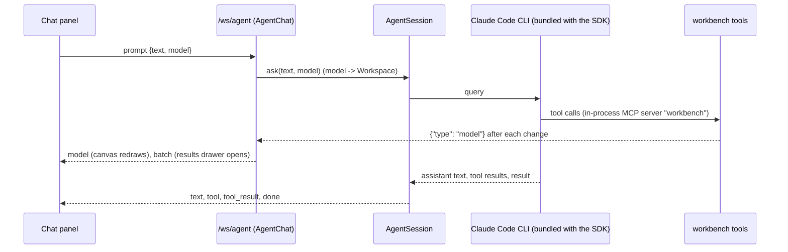

# agent

The in-app modeling agent (`server/agent/`, `/ws/agent`, `web/js/agent.js`): a Claude Agent SDK session that edits the user's model through workbench tools. Read this before changing its tools, prompt, isolation, authentication, or the chat panel.

## Flow

- The browser owns the model and sends it with every prompt. `Workspace` keeps a copy that is validated on every change (an invalid result is reverted and reported to the agent as a tool error) and can be undone. After each change, the server pushes the model back, and `applyAgentModel` adopts it, lays out new entities, and marks any live run as stale.
- Each prompt runs as a task, so `interrupt` gets through. `reset` starts a new SDK session.

## Tools (`tools.py`)

get_model, list_types, add_entity, update_entity, remove_entity, connect, update_link, disconnect, replace_model, undo, insert_template, set_group, calibrate_group, define_type, set_scenario, run, run_batch, list_sources, propose_changes. Reading other projects (Read/Grep/Glob, proposals) is covered in the sources card.

- Tool results are short text: `brief()` gives the key numbers per entity, and `compare()` gives mean ± CI per scenario. Simulations run in a worker thread.
- `define_type` writes **YAML only**, to `libraries/<lib>/types/<name>.yaml`. Names must match `[a-z][a-z0-9-]*`. The library is reloaded after writing, and the file is restored if the new type breaks it. The agent has no way to write Python behaviors, and the system prompt tells it to ask the user instead.
- Adding a tool: write a `make_<name>(env)` factory (use `guarded(...)`, and set `changes=True` if it edits the model), then add it to both `TOOL_FACTORIES` and `TOOL_NAMES`. `test_tool_names_match_factories` checks the two lists agree.

## Isolation and authentication (`session.py`)

- `tools=[]` turns off every built-in tool (Bash, file edits, web). With registered sources it is `["Read", "Grep", "Glob"]`, guarded by a hook (see the sources card). `allowed_tools` lists only the workbench tools, and `can_use_tool` denies anything else.
- `setting_sources=[]` and `skills=[]` keep the agent from loading this repo's CLAUDE.md, hooks, permissions or skills, which are for developing the workbench, not for using it.
- At import time, `strip_api_keys()` removes `ANTHROPIC_API_KEY` and `ANTHROPIC_AUTH_TOKEN` from the server's environment. The SDK passes the server's environment on to the CLI, and its `env` option can add variables but not remove them, so this is the only way to make sure the CLI uses its own login (the user's subscription). `/api/agent/status` reports which keys were removed.
- The model is the login's default. Set `SIMBENCH_AGENT_MODEL` to override it. A prompt has at most 40 turns.
- The SDK includes its own CLI (about 370 MB in `.venv`). If the CLI is not logged in, the error appears in the chat. Run `claude` once and log in.

## Testing

`tests/test_agent.py` calls the tool handlers directly and checks the session options, without calling a model. An end-to-end check (a real prompt) was run by hand in M7.
