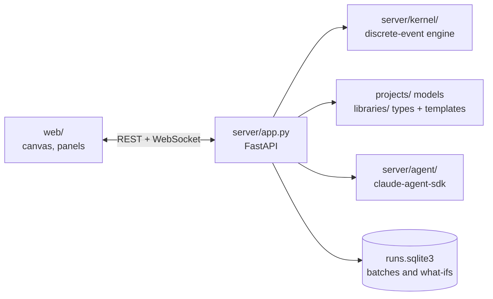

# architecture

How the workbench is split into parts, and where each part lives. Read this before adding a new top-level module.

## Parts

| Path | Status | Owns |
|---|---|---|
| `server/kernel/` | built (M1) | Clock, event queue, RNG streams, tier-1 behaviors, links, metrics, snapshot/fork, headless CLI. |
| `server/kernel/scenario.py`, `server/storage.py` | built (M6) | Scenario patches, batch runs with confidence intervals, what-if forks; the SQLite results store. |
| `server/kernel/composite.py` | built (M4) | Groups as composites: `flatten` (abstract stand-ins, boundary rewriting), boundary probes, calibration. |
| `projects/examples/` | built (M1) | Example models in YAML (`mm1.yaml`, `web-backend.yaml`). |
| `server/app.py`, `web/` | built (M2) | FastAPI REST for models and types, a WebSocket that streams live runs, and the vanilla-JS canvas editor. Font Awesome is vendored. |
| `libraries/`, `server/kernel/library.py` | built (M3) | Item types (`extends` chains with merged defaults) and parameterized templates, as YAML. |
| `server/agent/`, `web/js/agent.js` | built (M7) | Claude Agent SDK session (subscription login, isolated from repo settings) and in-process MCP tools that edit the browser's model, run simulations and batches, and define YAML types. |

## Boundaries

- The kernel knows nothing about HTTP, files on disk (except `load_model`), or the agent. Everything above it talks to it through `ModelSpec`, `Simulation` and listener records.
- Models are data (pydantic `ModelSpec`, saved as YAML). Runtime state lives only in `Simulation`. The canvas and the agent edit models and never touch runtime objects directly.
- Listener records (`{"type": "send" | "deliver" | "drop" | "lost" | "unrouted", ...}`) are the contract for live visualization. Adding a field is fine. Renaming one breaks the UI.

## Tech choices

- Python 3.12 in `.venv`, pydantic v2, PyYAML, FastAPI and uvicorn. pytest, ruff and httpx for development.
- No build step for the frontend (decided in `project-plan.md`).
