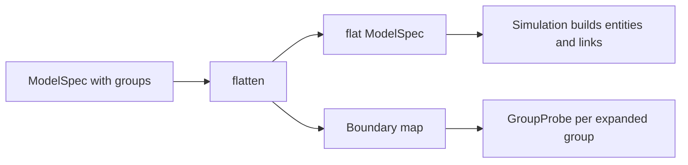

# composites

How groups become composites with boundary ports, abstract and expanded modes, boundary probes (`server/kernel/composite.py`), and calibration (`server/kernel/calibrate.py`). Read this before changing groups, `flatten`, probes, `/api/calibrate`, or how the canvas collapses groups.

## Model

```yaml
groups:
  - id: pool                      # same namespace as entity ids, no '.'
    name: App pool
    template: web/lb-pool         # provenance only
    inputs:  {in: pool_lb.in}     # boundary port -> inner entity.port
    outputs: {out: pool_join.out}
    mode: expanded                # or abstract
    abstract:                     # required for abstract mode
      type: server                # any item type whose ports include the boundary names
      params: {servers: 12, service: {dist: exp, mean: 0.12}}
      calibration: {...}          # set by calibration, informational only
    pos: [x, y]                   # collapsed node position on the canvas
```

Members are the entities with `group: <id>`. Groups are one level deep: a group cannot contain another group. An `entity.group` without a `GroupSpec` is only a visual frame.

## Compile step



- `Simulation.__init__` calls `flatten(model)`. `sim.model` is the model as written, and `sim.flat` is what actually runs.
- In abstract mode, the members and their internal links are dropped. A stand-in entity with id = group id takes their place. Outside links to inner boundary ports, or to `group.port`, are rewritten to `group.<boundary>`. A link into a non-boundary inner port is a `ModelError`.
- In expanded mode, `group.port` references are rewritten to the inner port.
- Rewritten connections keep their original key (`id` or `from->to`). Link metrics and the canvas animation depend on this.

## Probes and calibration

- Each expanded group with a boundary gets a `GroupProbe`, kept on the `Simulation` so snapshots and forks carry it. Delivery to a boundary-input port counts as entering the group. A send from a boundary-output port counts as exiting. `message_gone` (drop, link loss, unrouted) closes the message as dropped. Messages are tracked by message id, so a behavior that creates new messages inside the group breaks the tracking.
- `summary()["groups"][gid]` reports entered, exited, dropped, inside, loss, throughput, arrival_rate and residence (samples).
- Calibration (`calibrate.py`) fits one of two stand-ins:
  - **server** (the default when a member reports utilization): c servers with an exponential service time S. The group's capacity μ comes from one run. Each `server` member can handle `served / (utilization × span)` jobs per time when it is fully busy. Dividing that by the member's share of the group's arrivals gives the group arrival rate at which the member saturates. The smallest of these is the bottleneck. Then c/S = μ, and c is the smallest server count whose M/M/c mean residence (Erlang C) at the measured arrival rate reaches the measured mean. With capacity held fixed, residence grows with c. The stand-in saturates where the group does. If the measurement was taken at or above capacity, c is the bottleneck's own server count.
  - **delay**: lognormal(mean, std) residence with no capacity limit. It is valid only near the measured arrival rate. It is used when no member reports utilization (machines, Python behaviors, pure delays), or when requested with `kind: delay`.
  - Measured loss becomes `error_rate` on either stand-in.
- `run_calibration(model, Request(group, until, seed, kind), library, max_events)` runs the model with that group forced to expanded (other groups unchanged), and returns `(sim, Measurement, stand_in)`. `POST /api/calibrate {model, group, until, seed, kind}` (capped at 2M events) and the agent's `calibrate_group` both use it.
- Limits of the server fit: it assumes Poisson-like arrivals and exponential service, ignores finite queues (`queue_capacity`) inside the group, and folds the fixed latency into a longer service time with more servers. Calibrate again if the arrival pattern changes a lot.

## UI

- Abstract groups are drawn as one stacked node (the `Editor.nodes()` view layer). Links map through `endpoint()`, and internal links are hidden.
- Double-click a frame header or a collapsed node to toggle the mode. Abstract mode needs an `abstract` behavior first.
- The group inspector has: a mode switch, the boundary maps as JSON, the stand-in type and params, calibration details, a Calibrate button, Focus (expand this group and collapse every other group that has an abstract behavior), Ungroup (rewrites `group.port` references to inner ports first), and live metrics (the probe when expanded, the stand-in's metrics when abstract).
- Inserting a template creates its `GroupSpec` from the template's `inputs` and `outputs`.
- The entity inspector's **group** field, and the same field for a multi-selection, move entities into a group or out of one (`js/groups.js` `setEntityGroup`).
  - Every touched group's spec is brought back in step with its members. It is created when the group is new, and removed when the group ends up empty.
  - `group.port` references are inlined first.
  - Boundary names that still map to a member port are kept, and so are ports no link touches. Ports wired only inside the group are dropped.
  - Each port that a link newly crosses gets a boundary entry named after the port, or `entity_port` when that name is taken.
  - A group name must not contain `.` or equal an entity id.

## Known limits

- No nested groups.
- The stand-in is tier-1: a server or a delay, plus loss. It is not load-dependent beyond M/M/c queueing.
- Calibration without servers in the group (a delay stand-in) is load-specific.
