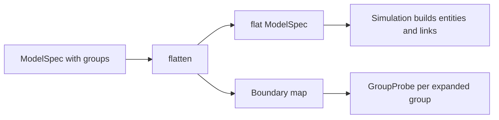

# composites

How groups become composites with boundary ports, abstract and expanded modes, boundary probes, and calibration (`server/kernel/composite.py`). Read this before changing groups, `flatten`, probes, `/api/calibrate`, or how the canvas collapses groups.

## Model

```yaml
groups:
  - id: pool                      # same namespace as entity ids, no '.'
    name: App pool
    template: web/lb-pool         # provenance only
    inputs:  {in: pool_lb.in}     # boundary port -> inner entity.port
    outputs: {out: pool_join.out}
    mode: expanded                # or abstract
    abstract:                     # required for abstract mode
      type: delay                 # any item type whose ports include the boundary names
      params: {delay: {dist: lognormal, mean: 0.12, std: 0.05}}
      calibration: {...}          # set by calibration, informational only
    pos: [x, y]                   # collapsed node position on the canvas
```

Members are the entities with `group: <id>`. Groups are one level deep: a group cannot contain another group. An `entity.group` without a `GroupSpec` is only a visual frame.

## Compile step



- `Simulation.__init__` calls `flatten(model)`. `sim.model` is the model as written, and `sim.flat` is what actually runs.
- In abstract mode, the members and their internal links are dropped. A stand-in entity with id = group id takes their place. Outside links to inner boundary ports, or to `group.port`, are rewritten to `group.<boundary>`. A link into a non-boundary inner port is a `ModelError`.
- In expanded mode, `group.port` references are rewritten to the inner port.
- Rewritten connections keep their original key (`id` or `from->to`). Link metrics and the canvas animation depend on this.

## Probes and calibration

- Each expanded group with a boundary gets a `GroupProbe`, kept on the `Simulation` so snapshots and forks carry it. Delivery to a boundary-input port counts as entering the group. A send from a boundary-output port counts as exiting. `message_gone` (drop, link loss, unrouted) closes the message as dropped. Messages are tracked by message id, so a behavior that creates new messages inside the group breaks the tracking.
- `summary()["groups"][gid]` reports entered, exited, dropped, inside, loss, throughput, arrival_rate and residence (samples).
- `suggest_abstract` fits a `delay` stand-in: residence becomes lognormal(mean, std) and loss becomes `error_rate`. It has no capacity limit, so it is only valid near the measured arrival rate (this is recorded in `calibration.note`). If load changes a lot, calibrate again.
- `POST /api/calibrate {model, group, until, seed}` runs the model with that group forced to expanded (other groups unchanged), capped at 2M events. It returns `{probe, abstract, truncated, ...}`.

## UI

- Abstract groups are drawn as one stacked node (the `Editor.nodes()` view layer). Links map through `endpoint()`, and internal links are hidden.
- Double-click a frame header or a collapsed node to toggle the mode. Abstract mode needs an `abstract` behavior first.
- The group inspector has: a mode switch, the boundary maps as JSON, the stand-in type and params, calibration details, a Calibrate button, Focus (expand this group and collapse every other group that has an abstract behavior), Ungroup (rewrites `group.port` references to inner ports first), and live metrics (the probe when expanded, the stand-in's metrics when abstract).
- Inserting a template creates its `GroupSpec` from the template's `inputs` and `outputs`.

## Known limits

- No nested groups.
- The stand-in only covers tier-1 behavior: delay plus loss.
- Calibration is load-specific.
