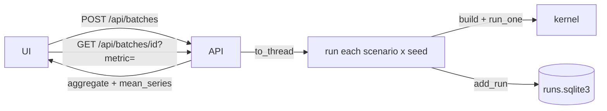

# scenarios

What-if scenarios, batch runs over seeds, the what-if fork from a paused run, and where results are stored (`server/kernel/scenario.py`, `server/storage.py`, the `/api/batches` endpoints, `web/js/results.js`). Read this before changing patches, batch statistics, the results store, or the results drawer.

## Scenarios in the model

```yaml
scenarios:
  - id: app1-link-down
    name: Link to app1 fails at t=100
    patches:
      - {entity: db, param: service, value: {dist: exp, mean: 0.04}}    # before the run
      - {at: 100, link: "lb.app_a->app1.in", field: up, value: false}  # during it
      - {group: pool, mode: abstract}                                   # before the run only
```

- Every patch has exactly one target. `entity` + `param`, `link` (a connection key) + `field` (latency, bandwidth, loss, ordered, up), or `group` + `mode`. `PatchSpec` validates this.
- A patch without `at` is applied to a copy of the model by `apply_static`. A patch with `at` becomes a `patch` event in the queue, and `Simulation.apply_patch` applies it at run time.
- Run-time patches change `ctx.params` or `link.spec`, then call `Behavior.on_params_changed`. Most behaviors read params on every event. `Server` refreshes `servers` and `queue_capacity`, and starts queued jobs when servers are added. `Router` refreshes its weights and refuses changed route names, because those are ports. A group's mode can't change mid-run.
- Applied patches are listed in `summary()["patches"]`.

## Batches



- `run_one` samples every metric `samples` times. `flat_metrics` turns a summary into `{dotted.path: number}`, for example `entities.done.latency.mean` or `links.<key>.lost.value`. A machine's numeric variables are included as `entities.<id>.vars.<name>`, so batches can chart populations or counters.
- `aggregate` gives the mean, std and a **95% CI for the mean**, using Student's t up to 30 degrees of freedom. Seeds are 1..n, so a scenario and the baseline use the same seeds. That pairing reduces noise in the comparison.
- Limits: 200 runs per batch and 2M events per run. A capped run sets `truncated`, and the drawer shows a warning.
- `GET /api/batches/{id}` returns `aggregate` (per scenario and metric), `metrics`, and with `?metric=` the mean time series per scenario.

## What-if from a paused run

The WebSocket message `{"cmd": "whatif", "scenario", "horizon"}` forks the live simulation twice (`scenario.whatif`). One fork runs as is; the other applies the scenario's patches at the fork, with `at` measured from the fork time. Both forks share state and random streams, so the difference comes from the scenario alone. A test checks that the baseline fork equals simply continuing the run. The result is stored as a batch with `kind: whatif`.

## Store

`server/storage.py` uses SQLite (`runs.sqlite3` at the repo root, gitignored). It follows the forward-only migration list from the standard defaults: append to `MIGRATIONS`, and never edit an entry that has shipped. It opens a short-lived connection per call, because batches write from a worker thread.

## Results drawer (`web/js/results.js`)

- Two SVG charts: dot + whisker (mean ± 95% CI per scenario, with a reference line at the baseline), and the metric over time (2px lines, end dots, crosshair tooltip). There is a legend, and a table view showing the change versus baseline.
- Scenario colors use the dataviz categorical slots for dark mode, assigned in fixed order by the scenario's position in the batch, with the baseline first. They were validated against the panel surface `#151a21` (all checks pass). The line chart's y-axis fits the data; only bars need a zero baseline.
- The model inspector holds the scenarios as JSON, a summary of each scenario's patches, "Compare over seeds", and "What if, from here".
