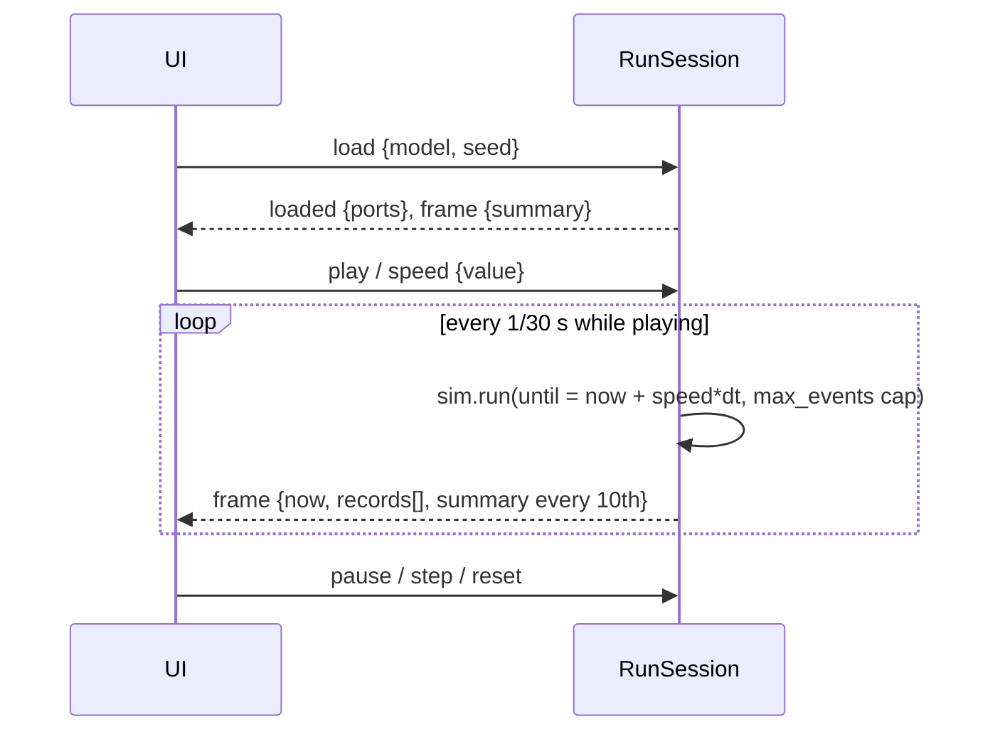

# server-and-canvas

The FastAPI server (`server/app.py`) and the browser UI (`web/`). Read this before changing the REST or WebSocket protocol, the canvas editor, or how live runs are streamed.

## Running

`.venv/bin/python -m server [--port 8765] [--reload]`, then open `http://127.0.0.1:8765/`. Use another `--port` if 8765 is taken.

## REST

| Route | Purpose |
|---|---|
| `GET /api/types` | Behaviors with `icon`, default `inputs`/`outputs`, and `params` (each behavior's `params_schema`) |
| `GET /api/models` | `*.yaml` under `projects/`, as `{path, name}` |
| `GET` / `PUT /api/models/{path}` | Load as JSON, or validate and save as YAML. `model_path()` refuses paths outside `projects/` and anything that isn't `.yaml`. |
| `POST /api/validate` | Returns `{ok, ports}` or `{ok: false, error}`. The UI calls it (debounced) after every edit to learn ports, because router ports depend on params. |

## WebSocket `/ws/run`

One `RunSession` (one `Simulation`) per connection. The protocol is documented in the `RunSession` docstring.

- `speed` is simulated time per real second. If a frame hits `MAX_EVENTS_PER_FRAME`, the frame says `lagging: true` and the sim falls behind real time instead of freezing the server.
- `records` are the kernel listener records, capped at `MAX_RECORDS_PER_FRAME`. The overflow count goes in `dropped_records`. The canvas only needs a sample to animate.
- The run uses the model as it was sent with `load`. The UI marks itself stale after any edit and sends a fresh `load` on the next play, step or reset.

## Frontend (`web/`, vanilla ES modules, no build)

- `js/main.js` handles app state, the palette, the inspector (fields generated from `params_schema`, with values typed as JSON), the toolbar, saving and auto-layout.
- `js/canvas.js` is the `Editor`. It handles pan and zoom, dragging nodes (snapped to 8px), and dragging from an output port to an input port to connect (a new link replaces an existing link from that output). Delete removes the selection. The editor also does the live drawing: amber dots move along the link Bézier curves between `t` and `arrive`, and red flashes mark drops and losses.
- `js/icons.js` draws Font Awesome glyphs on the canvas by reading the icon's `--fa` CSS variable (Font Awesome 7). The font is vendored in `web/vendor/fontawesome/` (Free 7.3.1). Add an icon by naming it in a behavior's `icon`.
- Link identity on both sides is `id` or else `"from->to"` (`linkKey` in JS, `ConnectionSpec.key()` in Python). Keep them in sync.

## Gotchas

- `Simulation.summary()` calls `start()`, because behaviors create their state in `on_start`. Don't read behavior attributes before the run has started.
- The canvas fills `.stage` with absolute positioning. Sizing it in normal layout let the grid row grow, and the page scrolled when the canvas took focus.
