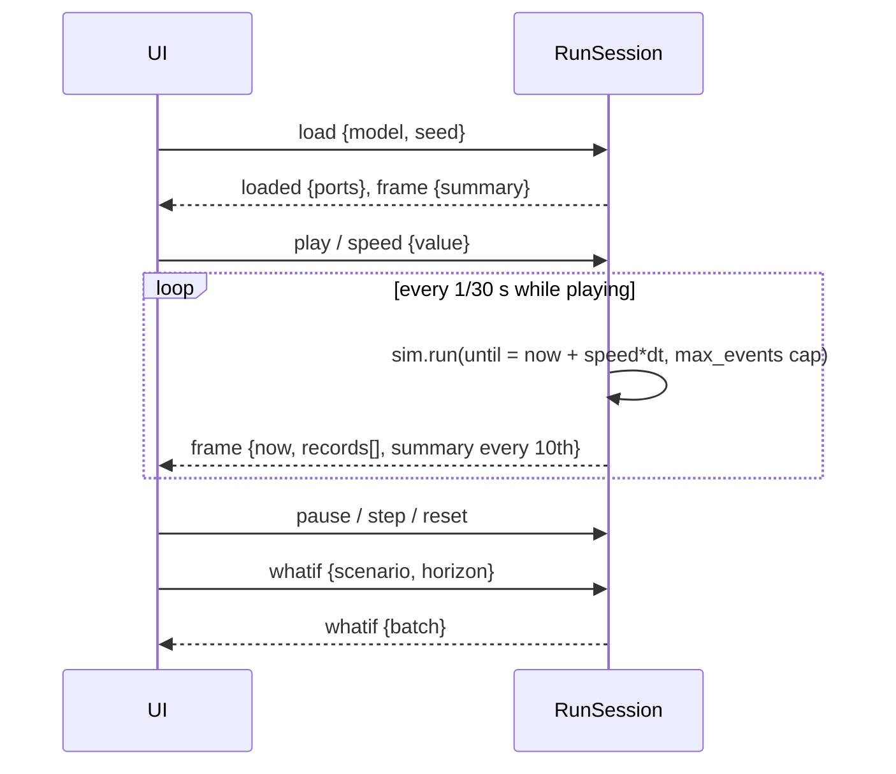

# server-and-canvas

The FastAPI server (`server/app.py`) and the browser UI (`web/`). Read this before changing the REST or WebSocket protocol, the canvas editor, or how live runs are streamed.

## Running

`.venv/bin/python -m server [--port 8765] [--reload]`, then open `http://127.0.0.1:8765/`. Use another `--port` if 8765 is taken.

## REST

| Route | Purpose |
|---|---|
| `GET /api/types` | Behaviors with `icon`, default `inputs`/`outputs`, and `params` (each behavior's `params_schema`) |
| `GET /api/models` | `*.yaml` under `projects/`, as `{path, name}` |
| `GET` / `PUT /api/models/{path}` | Load as JSON, or validate and save as YAML. `model_path()` refuses paths outside `projects/` and anything that isn't `.yaml`. |
| `POST /api/batches`, `GET /api/batches[/{id}]` | Batch runs over scenarios and seeds, and their results (see the scenarios card) |
| `POST /api/validate` | Returns `{ok, ports}` or `{ok: false, error}`. The UI calls it (debounced) after every edit to learn ports, because router ports depend on params. |

## WebSocket `/ws/agent`

The agent chat. See the agent card.

## WebSocket `/ws/run`

One `RunSession` (one `Simulation`) per connection. The protocol is documented in the `RunSession` docstring.

- `speed` is simulated time per real second. If a frame hits `MAX_EVENTS_PER_FRAME`, the frame says `lagging: true` and the sim falls behind real time instead of freezing the server.
- **Auto speed.** On `load`, `suggested_speed` runs a fork of the fresh sim for up to 5000 events, counts the message deliveries, and suggests the speed that shows about 8 deliveries per real second, clamped to the slider's range (0.01 to 1000). The `loaded` message carries it. The UI follows it (the label shows `auto`) until the slider is moved, and clicking the label returns to auto. At a fixed 1×, slow models or models with zero-latency links looked frozen.
- **Step runs to the next message delivery**, not one kernel event. Timers and other internal events run on the way, capped at `STEP_MAX_EVENTS`. The frame has `step: true`. The client animates each delivery along its link in wall time (`STEP_HOP_MS`), then pulses the receiving entity, and the status line names the receiver. The flag comes from the server because a step that first needs a `load` gets the load's frame first.
- While playing, every delivery pulses its entity (at most one pulse per entity at a time), and zero-latency hops stay visible for `MIN_FLIGHT_MS`. Play on a finished run restarts it.
- Static files and `/` are served with `Cache-Control: no-cache`. The browser revalidates with the ETag, so an updated JS module is never run from a stale cache. Without this header, browsers guess a cache lifetime.
- `records` are the kernel listener records, capped at `MAX_RECORDS_PER_FRAME`. The overflow count goes in `dropped_records`. The canvas only needs a sample to animate.
- The run uses the model as it was sent with `load`. The UI marks itself stale after any edit and sends a fresh `load` on the next play, step or stop. The stop button (fa-stop) pauses and rewinds to t=0 with a fresh `load`; the server `reset` command remains.
- The play icon is swapped by class, never by replacing the `<i>`, and `button i` has `pointer-events: none`: frames arrive at 30 FPS, and replacing the element under the pointer between mousedown and mouseup loses the click.

## Frontend (`web/`, vanilla ES modules, no build)

- **Ports.** By default inputs sit on the left and outputs on the right. An entity with `dynamic_ports: true` (an inspector checkbox; a canvas-only field on `EntitySpec`, `None` when off so saved models and agent tool output omit it) places each linked port on its border facing the centre of the node(s) at the other end. `js/ports.js` computes targets as a distance along the border (so ports pass corners), spreads ports of one node at least 18px apart, and `settle` glides them there each frame. Links leave and enter along each port's outward normal. Outputs are drawn filled and inputs hollow, since the side no longer tells them apart. Aiming at node centres, not ports, keeps placement free of feedback.
- `js/main.js` handles app state, the palette, the inspector, the toolbar, saving and auto-layout. `js/fields.js` builds the inspector's fields from `params_schema` types: string, bool, enum, machine (a script editor), code (a plain script, such as the model's `globals`, shown when nothing is selected), and JSON for the rest.
- `js/canvas.js` is the `Editor`. It handles pan and zoom, dragging nodes (snapped to 8px), and dragging from an output port to an input port to connect (a new link replaces an existing link from that output). Delete removes the selection. The editor also does the live drawing: amber dots move along the link Bézier curves between `t` and `arrive`, and red flashes mark drops and losses.
- `js/icons.js` draws Font Awesome glyphs on the canvas by reading the icon's `--fa` CSS variable (Font Awesome 7). The font is vendored in `web/vendor/fontawesome/` (Free 7.3.1). Add an icon by naming it in a behavior's `icon`.
- Link identity on both sides is `id` or else `"from->to"` (`linkKey` in JS, `ConnectionSpec.key()` in Python). Keep them in sync.

## Gotchas

- `Simulation.summary()` calls `start()`, because behaviors create their state in `on_start`. Don't read behavior attributes before the run has started.
- The canvas fills `.stage` with absolute positioning. Sizing it in normal layout let the grid row grow, and the page scrolled when the canvas took focus.
