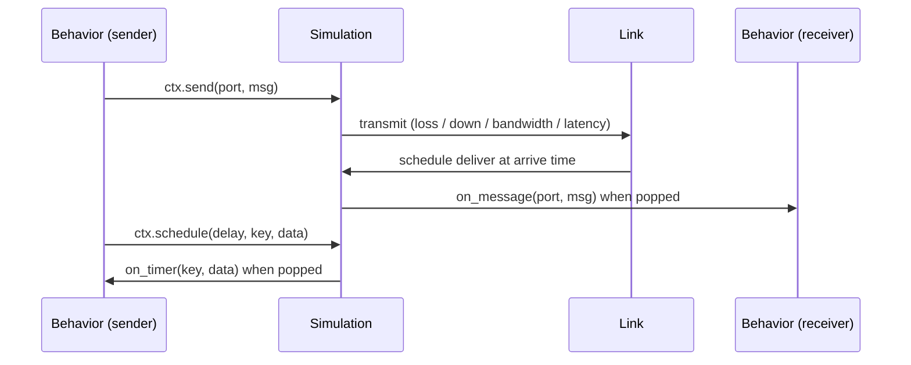

# sim-kernel

How the discrete-event kernel in `server/kernel/` works, and the rules it must keep. Read this before changing scheduling, behaviors, links, metrics or snapshots.

## Public surface

- `ModelSpec` / `EntitySpec` / `ConnectionSpec` (`model.py`) is the static model. Connections use `from: entity.port` and `to: entity.port`. Entity ids may not contain `.`.
- `Simulation(model, seed)` (`sim.py`) provides `step()`, `run(until=, max_events=)`, `summary()`, `snapshot()`, `restore()`, `fork()`, `add_listener()`, `next_time` and `now`.
- `BEHAVIORS` (`behaviors.py`) is the registry from type name to Behavior class. Built-in types are `source`, `server`, `delay`, `router` and `sink`.
- CLI: `.venv/bin/python -m server.kernel MODEL.yaml --until T --seed N [--json]`.

## Event flow

## Invariants

- **Determinism.** The same (model, seed) gives an identical `summary()`. Ties in time are broken by a monotonically increasing `seq`. All randomness comes from `RngPool.stream(name)`. Stream names are `entity:<id>`, `link:<key>` and `metric:<owner>:<name>`. Adding an entity must not change the draws of others, so never use the global `random` module.
- **Time never goes backwards.** `schedule()` rejects times before `now`, and `ctx.schedule()` rejects negative delays.
- **One link per output port.** Inputs may have many incoming links. This is checked at construction and raises `ModelError`.
- **Ordered links.** When `ordered: true` (the default), arrivals are clamped so they never overtake earlier messages on the same link.
- **Bandwidth.** Transmissions queue on the link: `depart = max(now, busy_until) + size / bandwidth`.
- **Snapshot.** `snapshot()` pickles the whole `Simulation` without listeners. Any new runtime state must be picklable: no lambdas or open handles stored on behaviors. `restore()` is only for snapshots this process made, never for uploaded data.
- **Behaviors only touch `self.ctx`.** The Context API (`now`, `params`, `rng`, `send`, `drop`, `schedule`, `message`, `counter`, `samples`, `gauge`) is the surface that tier-2 state machines and tier-3 scripts will share. Keep it small.

## Metrics

- `Counter`: a plain count.
- `Samples`: Welford mean and std, plus a 4096-value reservoir for p50, p95 and p99. The reservoir uses its own RNG stream.
- `Gauge`: a time-weighted average. `Server` reports `utilization` as `busy.avg / servers`.

## Adding a tier-1 behavior

Subclass `Behavior` and set `kind`, `description` and `icon` (a Font Awesome name). Implement `ports(params)` and the needed `on_*` methods, and register the class in `BEHAVIORS`. Add a test with a constant-time model whose result can be computed exactly.

## Failure modes

- The M/M/1 test (`tests/test_kernel.py`) checks results against queueing theory. If it drifts, suspect gauge time-weighting or the order of scheduling.
- A summary that differs between two runs with the same seed means something used an unseeded or shared RNG, or iterated a set.
