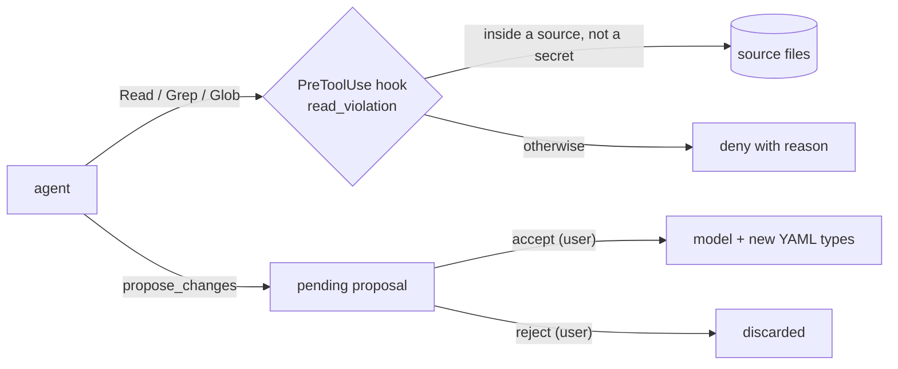

# sources

How the agent reads other projects to build models from them (`server/sources.py`, the read guard in `server/agent/session.py`, `propose_changes`, and the proposal preview and provenance in the UI). Read this before changing what the agent may read, the proposal flow, or provenance references.

## Registered sources

- The user registers a project directory by name in the Agent tab (Sources). The registry is `.simbench/sources.json`, which is gitignored because the paths are specific to this machine. The API is `GET/POST /api/sources` and `DELETE /api/sources/{name}`.
- `SourceRegistry.add` refuses relative paths, paths that don't exist, `/`, the home directory, and anything fewer than 3 path parts deep.
- `check_readable(path)` resolves symlinks and `..`, then requires the path to be inside a registered source and not a likely secret (`.env*`, keys, `id_*`, `.netrc`, credentials, `*secret*` file names).

## What the agent may do with them

- With at least one source registered, the session gets `tools=["Read", "Grep", "Glob"]` and `add_dirs` set to the source paths. Its `cwd` is an empty `.simbench/agent-cwd`. It still has no Bash, edits or web.
- **Enforcement is the `PreToolUse` hook** (`guard_read` → `read_violation`). It checks every call, including tools in `allowed_tools`, which skip `can_use_tool`. Read needs `file_path` inside a source. Grep and Glob need a `path` inside a source. Patterns can't be absolute or contain `..`.
- If the registered sources change, the session reconnects with `resume=<session id>`, so the conversation continues with the new tools and prompt.
- The system prompt lists the sources and a procedure: survey, map to entities, types and machines, state the assumed timings, record provenance, and call `propose_changes`. The agent must never apply an extracted model directly.

## Proposals

- `propose_changes(summary, notes, model_yaml, types)` validates the model against a **scratch copy** of the libraries with the new types added. Nothing is written yet. The proposal is pushed to the browser.
- The UI (`web/js/proposal.js`) shows the proposed model as a diff: new entities with a dashed green outline and NEW, changed ones in amber with CHANGED, and removed ones as faded red ghosts. Existing entities keep their positions. Canvas edits are blocked until the user decides.
- **Accept** (`AgentChat.resolve`) writes the types with `write_types`, which writes them all and rolls them all back if the library won't load. It then adopts the model (undoable) and pushes it back. **Reject** discards the proposal. Either way, the agent learns the outcome from a note added to the next prompt.

## Provenance

- `EntitySpec.source` and a type file's `source:` hold references like `shop:src/orders.py:21-37`.
- The inspector's Source section (`web/js/provenance.js`) lists them. Clicking one calls `GET /api/sources/snippet?ref=`, which applies the same readability checks, and shows the lines around the reference with the range highlighted.
