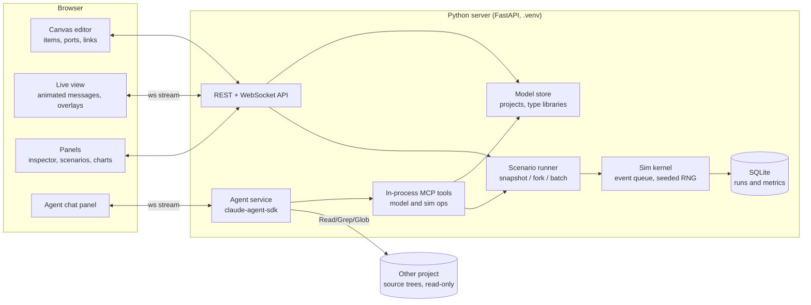

# Simulation Workbench — Project Plan

Source idea: `initial-idea.md` (local, gitignored)

## Goal

A local workbench where a Python server runs a discrete-event simulation of
**entities** that exchange **messages** and react to **events**, and a browser
canvas lets you build, inspect and watch the model. Models can be described at
coarse resolution and refined only where it matters ("zoom in to add detail").
You can branch a model into "what if" scenarios and compare results. A Claude
agent (Claude Agent SDK, using the local Claude Code subscription login, not an
API key) can edit the model, run scenarios, and derive item behavior by reading
other projects' source code.

## Non-goals (for now)

- Multi-user collaboration or hosted deployment. It runs on localhost for one user.
- Physics or continuous-time simulation. It is discrete-event only. Continuous
  values are approximated by events.
- Running or importing foreign code. The agent *reads* other projects and turns
  what it learns into workbench behavior definitions. It never executes that code.
- A general-purpose plugin marketplace. Type libraries are plain files in the repo
  or in a user folder.

## Architecture



### Core simulation model

| Concept | Meaning |
|---|---|
| **ItemType** | A reusable definition: icon (Font Awesome name), ports, parameters with defaults, behavior, and metrics it emits. |
| **Entity** | An instance of an ItemType placed in a model. It holds parameter overrides and runtime state. |
| **Port** | A named in/out endpoint on an entity, with an optional message schema. |
| **Connection** | A link between two ports. It has latency, bandwidth or capacity, loss rate, and ordering. Links are simulated objects too. |
| **Message** | A payload sent across a connection. It is delivered as an event at the receiver. |
| **Event** | A timestamped item in the kernel queue: message arrival, timer, or external stimulus. |
| **Behavior** | How an entity reacts to an event. There are three tiers, described below. |

**Behavior tiers**, from coarse to fine:

1. **Stochastic / black box.** Service-time distribution, queue size, error rate,
   and routing probabilities. This needs no code and is the default for a coarse item.
2. **Declarative state machine.** States, transitions on message or timer, guards,
   emitted messages, and counters. It is defined in YAML/JSON, and the agent
   generates it from source code.
3. **Python behavior script.** A small `on_event(ctx, event)` function for cases the
   first two tiers can't express. It runs in the kernel process with a restricted
   API surface (`ctx.send`, `ctx.schedule`, `ctx.state`, `ctx.rng`, `ctx.metric`).

### Resolution: high level to low level

- Any entity can be **composite**: it contains a sub-model, made of child entities
  and links, whose boundary ports map to the parent's ports.
- Each composite has two modes:
  - **abstract**: its own tier-1 or tier-2 behavior stands in for the whole subtree.
  - **expanded**: the children are simulated.
- **Focus** means expanding only the composites along a path of interest. Everything
  else stays abstract, which keeps runs fast.
- **Calibration loop.** Run the expanded version, measure it at the boundary
  (latency distribution, throughput, error rate), and write the results back as the
  abstract behavior. The coarse model then stays honest. The agent can drive this.
- On the canvas, double-clicking a composite drills into it, with breadcrumb
  navigation. Expanded composites show as a framed group.

### Type libraries and templates

- A **library** (kit) is a folder of ItemTypes and **templates**, stored in
  `libraries/<name>/`. Examples: `web-backend`, `queueing`, `iot`.
- A **template** is a pre-wired sub-model with parameters, for example
  "load-balanced service ×N". Instantiating a template creates a composite.
- Types can extend other types (`extends: queueing/server`) and override
  parameters or behavior.
- Projects pin the libraries they use, in `project.yaml`.
- Everything is plain YAML/JSON so it diffs well in git and the agent can edit it.

### What-if scenarios

- A **scenario** is a base model plus a list of **patches**. A patch can be a
  parameter change, an added or removed entity, a fault injection (a link goes down
  at t=…, a node gets slow), a load profile, or a resolution or focus change.
- Runs are deterministic for a given (model, scenario, seed). A batch runs N seeds.
- **Snapshot and fork.** Pause a run, snapshot the kernel state, and fork a new
  branch with a patch applied ("what if this node fails right now?").
- Run results go to SQLite: time series per metric, event log (sampled), and summary
  stats. A comparison view overlays scenarios.

### Agent (Claude Agent SDK on the subscription)

- Uses the `claude-agent-sdk` Python package. It drives the local Claude Code CLI,
  which uses whatever login `claude` already has, so a subscription works without an
  API key. The server **removes `ANTHROPIC_API_KEY` from the agent's environment**
  so it can't silently fall back to API billing.
- Uses a long-lived `ClaudeSDKClient` session per browser chat. Messages stream to
  the chat panel over a WebSocket.
- **Custom tools.** An in-process SDK MCP server exposes workbench operations:
  `list_types`, `get_model`, `add_entity`, `connect`, `set_params`, `define_type`,
  `create_template`, `expand`/`collapse`, `create_scenario`, `run`,
  `get_metrics`, `snapshot`, `fork`, and `compare_runs`.
- **Reading other projects.** Built-in `Read`, `Grep` and `Glob` are allowed only on
  directories the user registers as "sources" (`add_dirs`). `Bash`, `Write` and
  `Edit` are disabled for those paths. A permission hook enforces the allowlist.
- **Behavior extraction flow.** The user points at a repo or module. The agent maps
  components, message flows and state machines, then proposes ItemTypes and a
  wiring. The proposal shows as a **pending diff** on the canvas (ghosted items)
  that the user accepts or rejects. Each generated type records where it came from
  (file:line references).
- Subagents or skills handle recurring jobs: "extract-behavior", "calibrate
  composite", and "explore what-ifs" (sweep parameters and summarize).

### Frontend

- Vanilla ES modules served by FastAPI, with no build step at first. Font Awesome
  is vendored, so the app works offline. A single `<canvas>` with a small scene
  graph handles pan and zoom, hit-testing, drag, and drawing links port to port.
- Live mode animates message dots along links and badges queue lengths. A heat
  overlay shows utilization.
- Side panels: inspector for parameters, behavior and source refs; library palette;
  scenarios and runs; charts (a lightweight lib such as uPlot); agent chat.

## Proposed repo layout

```
server/            FastAPI app, sim kernel, model store, agent service
  kernel/          event queue, clock, rng, behavior runtimes
  model/           pydantic schemas, loaders, validation, patches
  agent/           SDK client wrapper, MCP tools, permission hooks
  storage/         SQLite + migrations
web/               index.html, js/ modules, css, vendor/fontawesome
libraries/         shipped type libraries + templates
projects/          user models (examples checked in)
tests/
cards/             agent context cards (agentic setup)
.claude/           settings, hooks, skills
requirements.txt   (.venv, gitignored)
```

## Milestones

- [x] **M0 Agentic setup.** Apply the chosen patterns from ai.memention.net/setup:
  `CLAUDE.md`, `project-plan.md`, `cards/`, standing defaults (venv and SQLite
  migrations), hooks such as ruff format and tests before stop, and
  `.claude/agent-setup.json`.
- [x] **M1 Kernel.** Event queue, clock, seeded RNG, entities, ports, links,
  messages, and tier-1 behaviors. Headless runs from the CLI. Determinism tests.
- [x] **M2 Server and canvas MVP.** FastAPI with REST for the model and a
  WebSocket for run streaming. Canvas to place items with FA icons, connect ports,
  edit parameters, and run, pause or step with animated messages.
- [ ] **M3 Libraries and templates.** YAML type and library format, inheritance,
  palette UI, templates turned into composites, save and load projects.
- [ ] **M4 Resolution.** Composites, abstract or expanded modes, drill-down UI,
  focus, and the calibration loop.
- [ ] **M5 Behaviors.** Tier-2 state machines with an editor/viewer, and tier-3
  Python scripts with the restricted ctx.
- [ ] **M6 Scenarios.** Patches, batch runs over seeds, snapshot and fork,
  SQLite results, comparison charts.
- [ ] **M7 Agent.** SDK session, chat panel, MCP model and sim tools, and a
  subscription-only auth check.
- [ ] **M8 Source reading.** Registered source dirs, read-only permissions, the
  extract-behavior skill, pending-diff accept or reject, and provenance links.

## Decisions

- 2026-11-25: Use our own discrete-event kernel rather than SimPy, because
  snapshot, fork and step-by-step control from the UI are first-class needs.
- 2026-11-25: Use FastAPI with WebSockets and a vanilla-JS canvas with no build
  step, to keep the stack small. Revisit if the UI grows past about 3k lines of JS.
- 2026-11-25: Store models and libraries as YAML/JSON files and run results in
  SQLite, so models diff well and results are queryable.
- 2026-11-25: Snapshot and fork pickle the whole `Simulation`. This is simple and
  exact, but every runtime object must stay picklable. Revisit if snapshots get
  large or need to survive code changes.
- 2026-11-25: Every random draw uses a named stream seeded from (seed, name), so
  adding an entity doesn't change the draws of existing entities. This keeps
  what-if comparisons fair.
- 2026-11-25: Use the agent through `claude-agent-sdk` on the subscription login,
  with `ANTHROPIC_API_KEY` stripped from its environment.

## Current state / handoff

- M0 is done: `CLAUDE.md`, `cards/` (architecture, sim-kernel, standing-defaults),
  hooks in `.claude/settings.json` (ruff format, tests before stop, no force push),
  and `.claude/agent-setup.json`.
- M1 is done: `server/kernel/` has the event queue, named RNG streams, five
  tier-1 behaviors (source, server, delay, router, sink), links with latency,
  bandwidth, loss, up/down and ordering, metrics, snapshot/fork, and the CLI
  (`python -m server.kernel`). There are 17 tests, including an M/M/1 check
  against queueing theory. Examples are in `projects/examples/`.
- M2 is done: `server/app.py` serves REST for types, models and validation, plus a
  `/ws/run` live-run WebSocket. `web/` is the canvas editor: a palette, drag to
  add, port-to-port connecting, a schema-driven inspector, play/pause/step/reset,
  a speed control, animated messages, metric badges, and saving to `projects/`.
  It was verified in Chrome against `web-backend.yaml`. There are 29 tests.
- Next: M3. Add YAML type libraries and templates, with inheritance and a
  palette grouped by library.

## Open questions

- Confirm that Claude subscription terms cover this personal, local use of the
  Agent SDK, and pin a minimum `claude` CLI and SDK version.
- Should tier-3 Python behaviors run in a subprocess for isolation, or in-process
  for speed?
- What is the first domain to model? It decides which library to ship first
  (web services, queueing, IoT, or other).
- Should results also export to CSV or Parquet for outside analysis?
